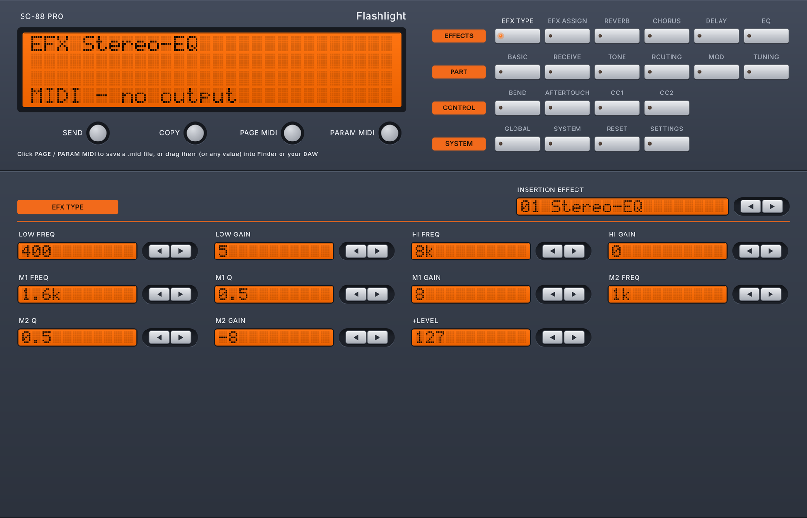

# SC88 Flashlight, C++ edition

A C++ rewrite of the Python/Pygame app in the repository root: a JUCE desktop app
styled after the 88emu front panel, on top of `sc88-core`, a UI-free library that
holds all of the SC-88 Pro knowledge.



## Building

You need CMake 3.22+ and a C++20 compiler. JUCE, nlohmann/json and Catch2 are
downloaded automatically the first time you configure.

**macOS** (Xcode or the Command Line Tools):

```sh
cmake -S cpp -B cpp/build -DCMAKE_BUILD_TYPE=Release
cmake --build cpp/build --parallel
open "cpp/build/app/SC88Flashlight_artefacts/Release/SC88 Flashlight.app"
```

**Windows** (Visual Studio 2022 with "Desktop development with C++", from a
Developer PowerShell):

```powershell
cmake -S cpp -B cpp/build
cmake --build cpp/build --config Release --parallel
& "cpp/build/app/SC88Flashlight_artefacts/Release/SC88 Flashlight.exe"
```

**Linux**: install JUCE's dependencies first (on Debian/Ubuntu: `libasound2-dev
libfreetype-dev libfontconfig1-dev libx11-dev libxrandr-dev libxinerama-dev
libxcursor-dev libxcomposite-dev libgl1-mesa-dev`), then build as on macOS.

Pass `-DSC88_BUILD_APP=OFF` to build only the core library and its tests. GitHub
Actions builds the app for macOS and Windows on every push and keeps the builds as
downloadable artifacts.

## Using the app

- The keys at the top right choose the page. Arrow keys step a value and send it to
  the selected MIDI output straight away; hold them to repeat.
- **SEND** sends the whole page (spaced by the SysEx delay), **COPY** puts the page's
  SysEx on the clipboard as hex.
- **PAGE MIDI** / **PARAM MIDI** save a .mid file of the page or of the last edited
  parameter to the save folder. Drag either button, or any value field, to drop a
  .mid file straight into Finder or a DAW.
- Click the effect name on EFX Type to pick from all 65 effects.
- The window resizes freely and keeps the panel's proportions.
- Settings (MIDI output, save folder, SysEx delay, repeat speed) are shared with the
  Python version.

`"SC88 Flashlight" --screenshots <folder>` renders every page to PNG files without
opening a window, which is handy for checking layout changes.

## App source (`app/source`)

| File | What it does |
| --- | --- |
| `MainComponent` | Front panel layout: LCD, action buttons, page keys; scales to the window |
| `pages/Pages` | Every editor page, built from value cells bound to the patch |
| `ui/Lcd` | Dot-matrix LCD drawn from `ui/LcdFontData.h` (generated from `gui_resources/RolandFont.png` by `tools/make_lcd_font.py`) |
| `ui/Controls`, `ui/Theme` | Panel, keys, wells, round buttons, LEDs, colours and the Inter font |
| `ui/ValueCell` | Label + LCD value + arrow keys; drag-out of a parameter |
| `MidiService`, `Exporter`, `Settings` | MIDI output with paced sends, .mid files and clipboard text, settings.json |

The panel labels use [Inter](https://rsms.me/inter/) (SIL Open Font License, see
`app/resources/fonts/Inter-LICENSE.txt`). JUCE is used under the AGPLv3.

## sc88-core

| File | What it does |
| --- | --- |
| `Sysex.h` | Roland DT1 messages and checksum, GS Reset, GM System On, hex formatting |
| `Param.h` | Parameter definitions, display codecs, value stepping, data byte encoding |
| `Tables.h` | Loads `data/parameter_pages.json`, `data/part_params.json` and `efx.json`; part, scale tune and EFX assign addressing |
| `Patch.h` | The editor's state for every page, and the messages each parameter or page produces |

## Data

The parameter tables live in JSON so they can be edited without recompiling:

- `efx.json` (repository root): the 65 insertion effects, generated by `generate_efx.py`.
- `data/parameter_pages.json` and `data/part_params.json`: exported from the Python app by
  `python3 tools/export_tables.py`.

## Tests

`tests/golden/golden.json` holds about 22,000 display strings and SysEx messages produced by
the Python app (`python3 tools/make_golden.py`). The tests check that the C++ core matches
every one of them. Hex text from the C++ core is always uppercase.

```sh
ctest --test-dir cpp/build --output-on-failure
```
